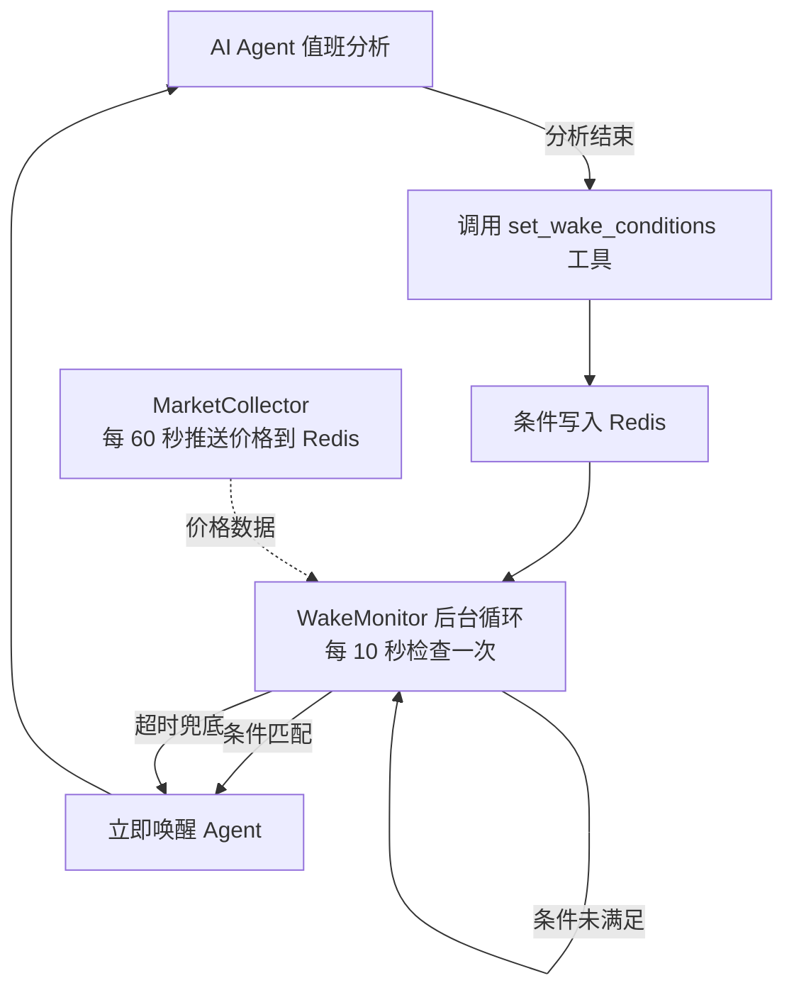

# AI 自主唤醒机制 — 事件驱动的智能体调度

## 背景

当前 Hub Agent 使用固定时间间隔（如 5 分钟）轮询市场，存在两个问题：
1. **浪费**: 市场平静时每 5 分钟调一次 AI 毫无意义，空耗 token
2. **迟钝**: 市场剧烈波动时 5 分钟太慢，可能错过最佳入场/平仓点

**核心思路**: 让 AI 在每次分析结束后，通过工具自主设定"唤醒条件"。系统在后台持续监控这些条件，满足时立即唤醒 AI 执行分析，不满足则继续等待。

---

## 架构总览



## 设计要点

### 1. 唤醒条件类型

AI 可以设置以下类型的条件（初期实现前 3 种，后续扩展）:

| 条件类型 | 说明 | 示例 |
|---------|------|------|
| `price_above` | 价格突破上方 | BTC > 88000 |
| `price_below` | 价格跌破下方 | BTC < 82000 |
| `change_pct` | 任意币种涨跌幅超过阈值 | 任一币种 ±2% |
| `rsi_above` | RSI 超买 | BTC RSI > 75 (未来) |
| `rsi_below` | RSI 超卖 | BTC RSI < 25 (未来) |
| `timeout` | 最大等待时间兜底 | 最多等 30 分钟必须醒来 |

> [!IMPORTANT]
> `timeout` 是强制兜底条件——即使所有条件都未触发，到时间也必须唤醒。这保证了 Agent 不会"睡死"。

### 2. AI 如何设置条件

在 `_build_cycle_prompt` 中要求 AI 在分析结束后输出结构化标记:

```
[WAKE_CONDITIONS]
price_above=BTCUSDT:88000
price_below=BTCUSDT:82000
change_pct=2.0
timeout=30
[/WAKE_CONDITIONS]
```

同时注册一个新工具 `set_wake_conditions`，通过 Function Calling 设置（Hub Agent 走 FC 路径更自然）。

### 3. 数据存储

使用 **Redis** 存储唤醒条件（不需要持久化到 DB，agent 停了条件自然失效）:

```
Key: hub:wake:{user_id}:{agent_id}
TTL: 3600 (1 小时兜底过期)
Value: JSON
{
  "conditions": [
    {"type": "price_above", "symbol": "BTCUSDT", "value": 88000},
    {"type": "price_below", "symbol": "BTCUSDT", "value": 82000},
    {"type": "change_pct", "value": 2.0},
  ],
  "timeout_minutes": 30,
  "created_at": "2026-03-30T08:00:00Z",
  "base_prices": {"BTCUSDT": 85000, "ETHUSDT": 2100}
}
```

### 4. 监控循环

`WakeMonitor` 嵌入 `_agent_loop`，替代固定 `asyncio.sleep(interval)`:

```python
# 伪代码
while not should_wake:
    await asyncio.sleep(10)  # 每 10 秒检查一次
    should_wake = await check_wake_conditions(...)
```

读取 MarketCollector 已推送到 Redis 的实时价格数据，零额外 API 调用。

---

## 用户审核项

> [!WARNING]
> **调度模式选择**: 实施后 Agent 将变为"事件驱动 + 超时兜底"模式。
> - AI 设了唤醒条件 → 条件触发时唤醒，否则等到超时
> - AI 没设条件 → 降级为原有的固定间隔模式
> 
> 这意味着 Agent 有可能在 AI 设定超时较长时（如 30 分钟），在这段时间内不会被主动唤醒。
> **是否接受这种行为？** 如果需要，可以加一个"最大静默时间"硬上限。

> [!IMPORTANT]
> **前端展示**: 当 Agent 处于"等待条件触发"状态时，前端日志是否需要展示当前等待的条件？
> 例如: `[等待中] BTC > 88000 或 BTC < 82000 或 超时(30min)`

---

## 文件变更清单

### 后端

---

#### [NEW] `app/services/hub/wake_monitor.py`

唤醒条件监控器核心模块:
- `WakeCondition` 数据类: 条件定义
- `WakeMonitor.set_conditions()`: 写入 Redis
- `WakeMonitor.check_conditions()`: 检查是否触发
- `WakeMonitor.wait_for_wake()`: 阻塞等待直到条件满足或超时
- `WakeMonitor.clear_conditions()`: 清除条件

#### [MODIFY] `app/services/agent/tools.py`

新增工具 `set_wake_conditions`:
- 参数: `conditions` (JSON 字符串，描述唤醒条件列表) + `timeout_minutes` (超时兜底)
- 功能: 解析条件 → 获取当前基准价格 → 写入 Redis
- 返回: 确认信息 + 条件摘要

#### [MODIFY] `app/services/hub/daemon.py`

改造 `_agent_loop`:
- `_execute_cycle` 后解析 AI 回复中的 `[WAKE_CONDITIONS]` 标记
- 如果有条件: 用 `WakeMonitor.wait_for_wake()` 替代 `asyncio.sleep(interval)`
- 如果没条件: 降级为原有的固定间隔 + 分时策略
- 唤醒时写一条系统日志: `[唤醒] BTC 突破 88000 触发`
- 保留 Phase 4 的智能跳过逻辑（与事件驱动互补）

改造 `_build_cycle_prompt`:
- 增加唤醒条件设定指引，教 AI 使用 `set_wake_conditions` 工具
- 告知 AI 上次的唤醒原因（如果是条件触发的）

#### [MODIFY] `app/services/hub/brain.py`

`SYSTEM_OVERVIEW` 中添加唤醒机制说明:
- 告知 AI 可以设定唤醒条件
- 给出示例和最佳实践

---

## 实施顺序

| 步骤 | 内容 | 难度 |
|------|------|------|
| 1 | 创建 `wake_monitor.py` — 核心监控器 | ⭐⭐ |
| 2 | 注册 `set_wake_conditions` 工具到 tools.py | ⭐ |
| 3 | 改造 `daemon.py` — 集成事件驱动循环 | ⭐⭐⭐ |
| 4 | 修改 prompt — 教 AI 使用唤醒机制 | ⭐ |
| 5 | 验证 + 日志观察 | ⭐ |

---

## 验证计划

### 自动化
- 部署后观察日志:
  - `[WakeMonitor] Conditions set: BTC>88000, BTC<82000, timeout=30min`
  - `[WakeMonitor] TRIGGERED: price_above BTCUSDT 88000 (current: 88150)`
  - `[HubDaemon] Agent #X WOKEN by condition: BTC > 88000`
- 对比优化前后的 AI 调用次数（应该显著减少）

### 手动
- 手动触发一次值班，观察 AI 是否在回复中设定了唤醒条件
- 观察 Redis 中是否正确写入了条件数据
- 等待条件触发，确认 Agent 被唤醒

---

## 开放问题

1. **最大静默硬上限**: 是否需要一个全局硬上限（如 60 分钟），不管 AI 设什么超时都不超过？
2. **条件组合逻辑**: 多个条件之间用 **OR**（任一满足就唤醒）还是支持 AND？建议初期全部 OR。
3. **前端展示**: 是否需要在 Hub 前端展示 Agent 当前等待的唤醒条件？
