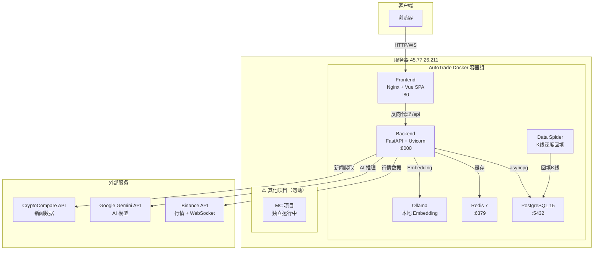
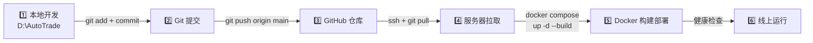
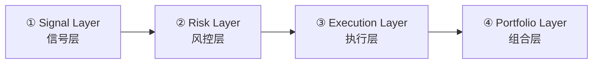

# AutoTrade 系统完整总结

> AI 驱动的加密货币交易系统 — 架构、工作流与功能全览

---

## 目录

1. [系统概述](#系统概述)
2. [服务器信息](#服务器信息)
3. [技术架构](#技术架构)
4. [开发与部署工作流](#开发与部署工作流)
5. [Docker 容器架构](#docker-容器架构)
6. [系统功能详解](#系统功能详解)
7. [API 路由总览](#api-路由总览)
8. [⚠️ 服务器注意事项 — MC 项目](#️-服务器注意事项--mc-项目)

---

## 系统概述

**AutoTrade** 是一个全栈 AI 驱动的加密货币量化交易系统，支持：

- 🤖 AI 智能交易代理（基于 Google Gemini）
- 📊 实时行情监控与 K 线图表
- 🔄 自动化策略引擎 + 网格交易
- 📰 新闻爬虫与情绪分析
- 🧠 向量化长期记忆系统（mem0 + LanceDB）
- ⚡ 四层交易流水线（Signal → Risk → Execution → Portfolio）
- 💼 模拟/实盘钱包管理

当前运行模式：**模拟交易**（simulation），初始模拟余额 100 USDT。

---

## 服务器信息

| 项目 | 值 |
|------|------|
| **服务器 IP** | `45.77.26.211` |
| **服务器 SSH** | `ssh root@45.77.26.211` |
| **SSH 密码** | `-6Bq%a3Wmq83TTQp` |
| **Web 访问地址** | `http://45.77.26.211` |
| **Web Basic Auth** | 用户名: `admin` / 密码: `AutoTrade2026` |
| **应用默认管理员** | 用户名: `admin` / 密码: `admin` |
| **数据库** | PostgreSQL 15, 用户: `autotrade`, 密码: `autotrade_secret_2026` |
| **GitHub 仓库** | `https://github.com/gemini251203-commits/AutoTrade.git` |
| **项目服务器路径** | `/root/AutoTrade` |

---

## 技术架构

### 整体架构图



### 技术栈

| 层 | 技术 |
|----|------|
| **前端** | Vue 3 + TypeScript + Vite 7 + Naive UI + TailwindCSS 4 |
| **后端** | Python 3.11 + FastAPI + Uvicorn + SQLAlchemy (async) |
| **数据库** | PostgreSQL 15 (Alpine) + Alembic 迁移 |
| **缓存** | Redis 7 (Alpine) + AOF 持久化 |
| **AI 模型** | Google Gemini API (gemini-2.5-flash 等) |
| **AI Embedding** | Ollama (本地运行，用于 mem0 向量化记忆) |
| **向量记忆** | mem0ai + LanceDB |
| **容器化** | Docker + Docker Compose |
| **反向代理** | Nginx (内嵌于 Frontend 容器) |
| **图表** | Lightweight Charts v5 (TradingView) |

---

## 开发与部署工作流

### 流程总览



### 第一步：本地开发 (`D:\AutoTrade`)

在本地 Windows 机器上进行代码修改：

```powershell
# 本地项目路径
D:\AutoTrade

# 前端开发（热重载）
cd D:\AutoTrade\frontend
npm run dev          # 启动 Vite 开发服务器 (localhost:5173)

# 后端开发
cd D:\AutoTrade\backend
uvicorn app.main:app --reload --port 8000
```

### 第二步：提交并推送到 GitHub

```powershell
cd D:\AutoTrade
git add .
git commit -m "描述修改内容"
git push origin main
```

### 第三步：服务器部署（从本地 Windows 一键远程部署）

```powershell
ssh root@45.77.26.211 "cd /root/AutoTrade && git pull && docker compose up -d --build"
```

### 第四步：验证部署

```powershell
# 检查服务状态
ssh root@45.77.26.211 "cd /root/AutoTrade && docker compose ps"

# 健康检查
ssh root@45.77.26.211 "curl http://localhost/api/health"

# 查看后端日志
ssh root@45.77.26.211 "cd /root/AutoTrade && docker compose logs -f backend"

# 查看前端日志
ssh root@45.77.26.211 "cd /root/AutoTrade && docker compose logs -f frontend"

# 查看数据库日志
ssh root@45.77.26.211 "cd /root/AutoTrade && docker compose logs -f db"
```

### 回滚操作

```bash
# 在服务器上
cd /root/AutoTrade
git log --oneline -5          # 查看最近 5 个 commit
git checkout <commit-hash>    # 切换到目标版本
docker compose up -d --build  # 重新构建
```

---

## Docker 容器架构

系统由 **6 个 Docker 容器** 通过 `autotrade-network` 桥接网络互联：

| 容器名 | 镜像 | 端口 | 功能 | 重启策略 |
|--------|------|------|------|----------|
| `autotrade-db` | `postgres:15-alpine` | 5432 | PostgreSQL 数据库 | unless-stopped |
| `autotrade-redis` | `redis:7-alpine` | 6379 | Redis 缓存 (AOF) | unless-stopped |
| `autotrade-backend` | 自构建 (Python 3.11) | 8000 (内部) | FastAPI 后端 API | unless-stopped |
| `autotrade-frontend` | 自构建 (Node→Nginx) | 80 (对外) | Vue SPA + Nginx 反向代理 | unless-stopped |
| `autotrade-ollama` | `ollama/ollama` | — | 本地 Embedding 模型 | unless-stopped |
| `autotrade-spider` | 自构建 (Python 3.11) | — | Binance K线深度回填 | no (一次性) |

### 数据卷（持久化）

| Volume | 用途 |
|--------|------|
| `postgres_data` | PostgreSQL 数据文件 |
| `redis_data` | Redis AOF 持久化 |
| `risk_configs` | 风控配置文件 |
| `lancedb_data` | LanceDB 向量化记忆数据 |
| `ollama_data` | Ollama 模型文件 |

### 关键环境变量

| 变量 | 值 | 说明 |
|------|------|------|
| `DATABASE_URL` | `postgresql+asyncpg://autotrade:autotrade_secret_2026@db:5432/autotrade` | 数据库连接 |
| `REDIS_URL` | `redis://redis:6379/0` | Redis 连接 |
| `JWT_SECRET_KEY` | 通过 `.env` 文件注入 | JWT 签名密钥 |
| `ENCRYPTION_KEY` | `npW1OPj68kfUESMss9xScP2hlLiJet0OjIx217_AZo8=` | API Key 加密密钥（固定） |
| `TRADING_MODE` | `simulation` | 交易模式 |
| `CRYPTOPANIC_API_KEY` | `a77948a52701c5...` | 新闻 API 密钥 |
| `GEMINI_API_KEY` | `AIzaSyAocsvDP_...` | Google Gemini AI 密钥 |
| `WEB_ACCESS_USERNAME` | `admin` | Nginx Basic Auth 用户名 |
| `WEB_ACCESS_PASSWORD` | `AutoTrade2026` | Nginx Basic Auth 密码 |

---

## 系统功能详解

### 1. 🔐 用户认证系统 (`/login`)

- JWT Token 认证（HS256，有效期 1440 分钟）
- Argon2 密码哈希（兼容 Python 3.13）
- 多账户快速切换支持
- Nginx Basic Auth 双重保护（站点级别）
- 自动创建默认管理员账户 (`admin/admin`)

---

### 2. 📊 仪表盘 (`/` — Dashboard)

- 账户总览：余额、持仓市值、总 PnL
- 实时市场行情卡片
- 快速操作入口

---

### 3. 📈 信号助手 (`/signal` — SignalAssistant)

- AI 驱动的交易信号分析
- 支持手动粘贴信号文本或 URL
- AI 自动解析信号参数（交易对、方向、杠杆、入场/止盈/止损价位）
- 多轮对话式信号确认
- SSE 流式响应（实时显示 AI 思考过程）

---

### 4. 💼 钱包管理 (`/wallet` — Wallet)

- 模拟钱包 + 真实钱包双模式
- 钱包余额总览、可用/冻结资金
- 资金划转、充值/提现操作
- 钱包重置功能
- 资产变动历史记录
- 支持绑定 Binance API Key（AES 加密存储）

---

### 5. 🔄 策略管理器 (`/strategy` — StrategyManager)

- 多策略添加/编辑/删除
- 策略开关控制（启用/禁用）
- 支持策略类型：
  - 趋势跟踪（Trend Following）
  - 均值回归（Mean Reversion）
  - 突破策略（Breakout）
  - 自定义量化策略
- 策略参数配置（交易对、杠杆、仓位模式等）
- 策略绩效统计

---

### 6. 🤖 AI 对话代理 (`/chat` — ChatAgent)

- 基于 Google Gemini 的 AI 交易助手
- 支持 Function Calling（工具调用）
- 可调用 25+ 交易工具（下单、查仓位、查行情等）
- SSE 流式响应
- 对话历史管理
- AI 记忆系统（mem0 向量化存储）

---

### 7. 🧠 Agent Hub (`/hub` — AgentHub)

- **AI 自主交易代理** — 自动轮询市场、分析行情、执行交易
- 核心组件：
  - **HubDaemon**：后台守护进程，管理 Agent 生命周期
  - **HubBrain**：AI 大脑，基于 Gemini 进行决策
  - **WakeMonitor**：事件驱动唤醒监控器
  - **ToolCompressor**：工具结果压缩器（减少 Token 消耗）
  - **MemoryConsolidator**：记忆坍缩引擎（每日生成董事会纪要）
  - **MemoryService**：向量化长期记忆服务
- 功能特性：
  - 动态轮询间隔（基于市场波动调整）
  - 事件驱动唤醒机制（`set_wake_conditions` 工具）
  - 批量工具调用优化
  - 滑动窗口消息管理
  - Token 消耗统计与优化
- Agent 操作：启动/停止/重启/手动唤醒

---

### 8. 🚀 自动驾驶仪 (`/autopilot` — AutopilotDashboard)

- 基于活跃策略的自动交易调度器
- 策略扫描与执行监控
- 自动下单 + 风控拦截
- 执行日志查看

---

### 9. 📰 新闻中心 (`/news` — NewsCenter)

- 加密货币新闻聚合
- 数据源：CryptoCompare API
- 新闻情绪分析
- AI 驱动的新闻影响评估
- 按交易对/类别过滤

---

### 10. 🔗 四层流水线监控 (`/pipeline` — PipelineMonitor)

- 四层交易决策流水线可视化：



- **信号层 (Signal)**：量化指标计算 + AI 研判
- **风控层 (Risk)**：止损/止盈检查、仓位限制、杠杆检查
- **执行层 (Execution)**：订单拆分、滑点控制、手续费计算
- **组合层 (Portfolio)**：投资组合平衡、相关性检查
- 流水线执行历史与统计

---

### 11. 📐 网格交易 (`/grid` — GridDashboard)

- 网格策略创建与管理
- 网格参数配置（上下界、网格数量、单格金额）
- 网格订单自动挂单
- 实时网格状态监控
- 网格利润统计

---

### 12. 🛡️ 风控配置 (`/risk-config` — RiskDashboard)

- 全局风控参数配置（YAML 格式）
- 断路器（Circuit Breaker）状态监控
- 风控引擎：
  - 最大持仓数量限制
  - 单笔最大仓位限制
  - 最大杠杆限制
  - 日亏损限额
  - 相关性检查
- 风控拦截日志

---

### 13. 📓 交易日志 (`/journal` — TradeJournal)

- 交易记录自动记录
- 交易复盘分析
- PnL 统计图表
- 持仓历史追踪

---

### 14. ⚙️ 设置 (`/settings` — Settings)

- AI 模型配置（API Key、模型选择）
- Binance API Key 绑定（加密存储）
- 用户偏好设置
- 交易对默认配置

---

### 15. 🔧 管理面板 (`/admin` — Admin)

- 用户管理（仅管理员可见）
- 系统状态监控

---

### 后台自动服务（无 UI 页面）

| 服务 | 频率 | 功能 |
|------|------|------|
| **MarketCollector** | 每 5 秒 | 从 Binance 采集 K 线数据 |
| **PriceStream** | 实时 WebSocket | Binance 实时价格推流 |
| **FundingRateService** | 定期 | 采集合约资金费率 |
| **NewsCrawler** | 定期 | 爬取加密货币新闻 |
| **TrendScheduler** | 每日 | 自动趋势分析 |
| **MemoryConsolidator** | 每日 00:05 CST | AI 记忆坍缩 → 董事会纪要 |
| **Autopilot** | 循环 | 扫描活跃策略并自动执行 |
| **HubDaemon** | 动态间隔 | AI Agent 自主交易循环 |
| **BinanceSpider** | 一次性 | K 线历史数据深度回填 |

---

## API 路由总览

后端提供 **21 组 API 路由**：

| 路由前缀 | 标签 | 功能 |
|----------|------|------|
| `/api/auth` | Authentication | 注册、登录、Token 刷新 |
| `/api/wallet` | Wallet | 钱包余额、划转、重置 |
| `/api/order` | Order | 下单、撤单、订单查询 |
| `/api/task` | Task | 任务管理 |
| `/api/market` | Market | K 线数据、实时行情、深度 |
| `/api/ai` | AI | AI 信号解析、流式对话 |
| `/api/position` | Position | 持仓查询、平仓 |
| `/api/risk` | Risk | 风控检查、风控状态 |
| `/api/grid` | Grid | 网格策略管理 |
| `/api/user` | User Config | 用户配置 |
| `/api/admin` | Admin | 管理员操作 |
| `/api/ws` | WebSocket | 实时价格推送 |
| `/api/strategy` | Strategy | 策略 CRUD |
| `/api/agent` | Agent | AI 对话代理 |
| `/api/journal` | TradeJournal | 交易日志 |
| `/api/news` | News | 新闻聚合 |
| `/api/pipeline` | Pipeline | 流水线监控 |
| `/api/trend` | Trend | 趋势分析 |
| `/api/funding` | Funding | 资金费率 |
| `/api/risk-config` | RiskConfig | 风控配置 |
| `/api/hub` | Agent Hub | AI 自主交易代理 |
| `/api/tools` | Tools | AI 工具注册表 |

---

## ⚠️ 服务器注意事项 — MC 项目

> [!CAUTION]
> **服务器 `45.77.26.211` 上还运行着一个独立的 MC 项目，千万不能影响到该项目的运行！**
> 所有 Docker 操作必须在 `/root/AutoTrade` 目录下使用 `docker compose` 命令，禁止使用全局 Docker 批量命令（如 `docker stop $(docker ps -aq)`、`docker system prune` 等），也不要重启 Docker 服务本身。

---

## 常用运维命令速查

```bash
# ==========================================
# 部署相关
# ==========================================

# 一键更新部署（从本地 Windows 执行）
ssh root@45.77.26.211 "cd /root/AutoTrade && git pull && docker compose up -d --build"

# 只重建后端
ssh root@45.77.26.211 "cd /root/AutoTrade && docker compose up -d --build backend"

# 只重建前端
ssh root@45.77.26.211 "cd /root/AutoTrade && docker compose up -d --build frontend"

# ==========================================
# 日志查看
# ==========================================

# 后端日志（实时跟踪）
ssh root@45.77.26.211 "cd /root/AutoTrade && docker compose logs -f --tail=100 backend"

# 所有服务日志
ssh root@45.77.26.211 "cd /root/AutoTrade && docker compose logs -f --tail=50"

# ==========================================
# 容器管理
# ==========================================

# 查看容器状态
ssh root@45.77.26.211 "cd /root/AutoTrade && docker compose ps"

# 重启全部服务
ssh root@45.77.26.211 "cd /root/AutoTrade && docker compose restart"

# 重启单个服务
ssh root@45.77.26.211 "cd /root/AutoTrade && docker compose restart backend"

# 停止所有 AutoTrade 服务
ssh root@45.77.26.211 "cd /root/AutoTrade && docker compose down"

# ==========================================
# 数据库操作
# ==========================================

# 进入数据库 shell
ssh root@45.77.26.211 "cd /root/AutoTrade && docker compose exec db psql -U autotrade -d autotrade"

# 进入 Redis shell  
ssh root@45.77.26.211 "cd /root/AutoTrade && docker compose exec redis redis-cli"

# ==========================================
# 健康检查
# ==========================================

# API 健康检查
ssh root@45.77.26.211 "curl -s http://localhost/api/health | python3 -m json.tool"
```

---

## 项目目录结构

```
D:\AutoTrade/
├── .agent/workflows/
│   └── deploy.md              # Gemini 自动化部署工作流
├── backend/
│   ├── Dockerfile             # 后端 Docker 镜像 (Python 3.11)
│   ├── requirements.txt       # Python 依赖
│   ├── alembic/               # 数据库迁移脚本
│   ├── risk_config.yaml       # 风控配置文件
│   └── app/
│       ├── main.py            # FastAPI 入口 + 生命周期管理
│       ├── api/               # 21 组 API 路由 (24 个文件)
│       ├── core/              # 核心模块 (配置/加密/限流/流水线/事件总线)
│       ├── db/                # 数据库会话管理
│       ├── middleware/        # 中间件 (错误处理/访问日志)
│       ├── models/            # ORM 模型 (21 个模型)
│       └── services/          # 业务逻辑
│           ├── agent/         # AI Agent (对话 + 自动驾驶)
│           ├── ai/            # AI Brain (Gemini 集成)
│           ├── hub/           # Agent Hub (自主交易代理)
│           ├── news/          # 新闻爬虫 + 情绪分析
│           ├── quant/         # 量化分析 (指标/缠论/趋势)
│           ├── risk/          # 风控引擎
│           ├── trading/       # 交易执行 (订单/条件单)
│           ├── execution/     # 执行引擎 (order_executor/position_manager)
│           ├── grid/          # 网格交易策略
│           ├── wallet/        # 钱包管理
│           └── portfolio/     # 投资组合
├── frontend/
│   ├── Dockerfile             # 前端 Docker 镜像 (Node→Nginx 多阶段构建)
│   ├── nginx.conf             # Nginx 配置 (反向代理 + SSE + Basic Auth)
│   ├── entrypoint.sh          # 容器启动脚本 (.htpasswd 生成)
│   └── src/
│       ├── views/             # 15 个页面组件
│       ├── components/        # 6 个复用组件
│       ├── stores/            # Pinia 状态管理
│       ├── api/               # Axios API 封装
│       ├── router/            # Vue Router (路由守卫)
│       └── composables/       # Vue 组合式函数
├── data_engine/
│   └── binance_spider.py      # Binance K线数据深度回填爬虫
├── docker-compose.yml         # 6 个容器编排配置
└── deploy.sh                  # 一键部署脚本
```
